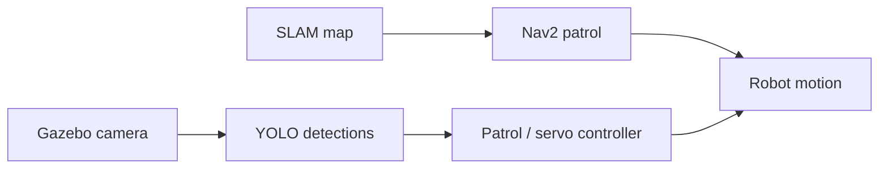

# VisioBot

VisioBot is a differential-drive robotics learning project for the LSPP2026 challenge. It contains ROS 2 Jazzy simulation, Nav2 patrol, YOLO detection and a controller that switches from patrol to approaching a detected person.

The repository also includes separate depth-estimation and TinyML exercises. The committed work reaches Day 35; it does not establish a completed 60-day robot or verified microcontroller inference.



This overview follows the Day 30 simulation. Its approach controller uses image bounding-box height, rather than metric depth.

## Start with the standalone exercise

Python 3 is enough to run the dry-run calculation; it does not connect to ROS or move a robot.

```bash
git clone https://github.com/SuhanVerse/visiobot.git
cd visiobot
python3 visual_servo_dry_run.py
```

The script prints angular and linear commands for three supplied image/depth measurements. It is separate from the ROS capstone controller.

## Build and launch the simulation

Use an existing ROS 2 Jazzy / Gazebo Harmonic environment with colcon, Xacro, the ROS–Gazebo bridges (`ros_gz_sim`, `ros_gz_bridge`, `ros_gz_image`), SLAM Toolbox, Nav2, `nav2_simple_commander`, `cv_bridge` and `vision_msgs`. The vision node also imports Ultralytics, NumPy and the bundled SORT tracker; SORT imports FilterPy, SciPy, Matplotlib and scikit-image. These Python dependencies must be available to the Python interpreter used by ROS. They are not fully declared or version-locked by the package manifests yet.

From the repository root:

```bash
source /opt/ros/jazzy/setup.bash
# Build the two Python packages used by this launch, without the other experiments.
colcon build --symlink-install --base-paths src/visiobot_core src/visiobot_vision
source install/setup.bash
ros2 launch visiobot_vision day30_capstone.launch.py
```

Run from this directory: the detector opens the root `yolov8n.pt` by relative name. The launch includes Gazebo and SLAM, starts Nav2 after 15 seconds, then starts the capstone after 25 seconds. A visible person model is needed for person detection; the empty world alone does not provide one. See the [local Gazebo model guide](learning_guides/gazebo_local_models_guide.md).

This is the committed launch target, not a fresh-machine or hardware certification. Use the simulation before considering a physical platform; the servo controller publishes velocity commands directly.

## Find the implementation

| Area | Source / notes |
| --- | --- |
| Robot, simulation and SLAM | [visiobot_core](src/visiobot_core) |
| Patrol and approach launch | [day30_capstone.launch.py](src/visiobot_vision/launch/day30_capstone.launch.py) |
| Controller and its current constants | [day30_capstone_node.py](src/visiobot_vision/visiobot_vision/day30_capstone_node.py) |
| Detection and tracking | [yolo_detector.py](src/visiobot_vision/visiobot_vision/yolo_detector.py) |
| Separate monocular-depth experiment | [depth_estimator_node.py](src/visiobot_vision/visiobot_vision/depth_estimator_node.py) |
| Desktop model conversion / benchmarks | [Day 31](daily_guides/day31_deliverable.md), [Day 32](daily_guides/day32_deliverable.md), [Day 34](daily_guides/day34_deliverable.md) |
| IMU serial-data collection | [Day 35 sketch](IDE_code/day35_edgeimpulse_collection/day35_edgeimpulse_collection.ino) |

The capstone currently uses a 200-pixel box-height threshold, a three-second lost-target timeout and a 15-second cooldown. Some daily guides describe earlier tuning values; use the linked source for the current behavior. Pixel height is an image-space approximation, not a calibrated stopping distance. Desktop benchmarks use synthetic inputs and do not measure an ESP32 deployment.

## License and upstream code

See [LICENSE](LICENSE) for the project license. Bundled third-party code retains its own notices, including Alex Bewley's [SORT tracker](src/visiobot_vision/visiobot_vision/sort.py) and the ROS/ViSP packages in `src/`; check those licenses before redistribution.
